<div align="center">

# ⚓ Valkyrien Skies + Eureka · Unofficial Port

### Build a ship. Make it fly. Bring your friends.

Valkyrien Skies 2 and Eureka Ships, combined into **one Fabric mod for Minecraft 26.3**,<br>
with cannons that aim anywhere, wireless buttons, a 3D wiring screen, a preview before you assemble<br>
and a lot of fixes on top.

[](https://github.com/BalloonKoala/valkyrien-skies-eureka-port/releases/latest)
[](https://discord.gg/nbZ9nH3aBb)


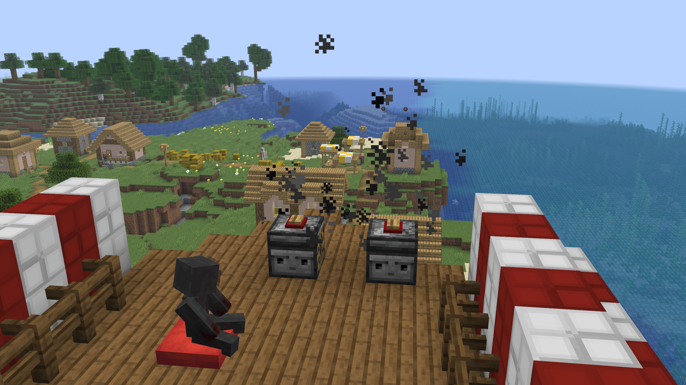

</div>

> [!IMPORTANT]
> This is an **unofficial** port. It isn't made or supported by the Valkyrien Skies team, so please don't send them bug reports for it.
> Got a problem, a suggestion, or just want to chat? **[Join the Discord!](https://discord.gg/nbZ9nH3aBb)**

## 📥 Download and install

1. Install the latest **[Fabric Loader](https://fabricmc.net/use/installer/)** for Minecraft **26.3**.
2. Download **[Fabric API](https://modrinth.com/mod/fabric-api)** `0.165.0+26.3`.
3. Download the mod from **[Releases](https://github.com/BalloonKoala/valkyrien-skies-eureka-port/releases/latest)**. It's the `.jar` file under *Assets*.
4. Put both jars in your `mods` folder and start the game with **Java 25**.

> [!NOTE]
> **The server and every player need it.**
> Fabric Language Kotlin and Forge Config API Port are already inside the jar, so you don't need to install them.
> **Don't** install the original Valkyrien Skies or Eureka next to this. It's all in this one jar.

## ⚓ Everything from Eureka is here

- Build a ship out of almost any blocks, then bring it to life with a **Ship Helm**
- **Balloons** lift it, **engines** burn fuel to drive it, and **anchors** hold it still
- **Floaters** and **ballast** help you balance it
- Real physics: ships tilt, turn, drift and crash
- Walk around on your ship while it moves

## ✨ What's new

### 🛳️ Rock-solid ships
Nothing on deck glitches anymore. Tested on a 36 m/s ship with 120 ms of ping:

- Fixed a crash that hit many Windows players as soon as a ship came into view (*Vertex buffer at slot 1 has been closed*)
- Players in survival are no longer pulled back while walking on a moving ship

- Players, mobs and items stay exactly where they're standing, even while the ship turns
- Mobs stop hopping and stop getting pulled across the deck
- Cows stay in their pens
- Mobs with no AI ride the ship instead of being left behind in the air
- Players with lag no longer shove things around from a spot they aren't really standing in

### ☸️ A proper captain's wheel
You stand on the deck with both hands on the wheel, not floating above it, and your mouse is no longer reversed while steering.

### 🛋️ Cushions on ships
Cushions work properly on ships now. Sit on them, break them, and use them as seats anywhere on deck.

**Driver's seat:** put a cushion on the spot in front of a helm and sit down. You're driving, in a real sitting pose.

### 💥 Cannons
A new block: an iron barrel on a wooden carriage with wheels, sitting on a swivel, so it can point **any direction**.

1. Place it. The barrel points the way you're facing.
2. **Aim it:** sneak and right click it with an empty hand, then look where it should fire. The barrel follows your view, straight up and straight down included. Let go of sneak to keep it there.
3. Open it and load **TNT**. It has 9 slots like a dispenser.
4. Fire it with a redstone pulse, or with a key from your seat (see the Wiring screen below). It uses 1 TNT and fires a cannonball out of the barrel.

The cannonball explodes when it hits something, and it can blow holes in ships. It fires exactly where the barrel points, even while your ship is moving and turning. Each cannon only fires from a signal touching it, so cannons side by side or stacked stay separate.

### 📡 Wireless Buttons
A button you never touch, in all 12 wood types: oak, spruce, birch, jungle, acacia, dark oak, mangrove, cherry, pale oak, bamboo, crimson and warped. The top is that wood, with a small red rim that glows when it fires.

You can't press it by hand and arrows don't press it. It only fires from a key you set, and it sends a 2 tick redstone pulse. It works with anything redstone can do: cannons, doors, lights, bells, traps, you name it.

### 🗺️ The Wiring screen
Open your helm and click the new **Wiring** button. You'll fly around a live 3D view of your ship, like in Blender.

- 🟠 **Orange dots** are your cannons, no buttons needed
- 🔴 **Red dots** are your wireless buttons
- 🔵 **Blue dots** are your contact points: every helm and cushion on that ship
- Dots show right through the walls, and lines show what's wired to what

| Control | What it does |
|---|---|
| <kbd>W</kbd> <kbd>A</kbd> <kbd>S</kbd> <kbd>D</kbd> | Fly |
| <kbd>Space</kbd> / <kbd>Shift</kbd> | Up / down |
| Right mouse drag | Look around |
| Left mouse drag | Rotate around the ship |
| Scroll wheel | Change flying speed |
| Sprint key | Fly faster |
| <kbd>Esc</kbd> | Done |

- **Set a key:** click an orange or red dot, then press any key on your keyboard. Do the same to change it. <kbd>Esc</kbd> cancels.
- **Rewire it:** drag its dot onto a blue dot. Every cannon and button starts out wired to the helm.
- Pressing a cannon's key fires it straight away. Mashing the key fires about as fast as redstone would.

**Firing it:** a key only works when all of this is true:

- ✅ The contact point is on that ship
- ✅ You're sitting on that helm or cushion
- ✅ You press the key

That means every gunner can have their own seat and their own cannons, even with everyone using the same key. Sitting on a cushion in front of a helm counts as both the helm and that cushion.

### 🔎 Check before you assemble
Pressing **Assemble** on a helm doesn't build the ship straight away anymore. You get a **Ship Info** screen first:

- How many blocks will become the ship, and how big it is
- A 3D view of **only** those blocks. Drag to turn it, scroll to zoom
- If your boat is touching a dock, the ground or anything else, you'll see it right there

Press **Assemble** under the info to build the ship, or **Cancel** to go fix it. If it's touching the ground or something huge, the count turns red and Assemble is greyed out.

### 🧱 Only your own blocks become ships
The game remembers every block players place. A ship can only be made of those, so a boat can't grab the ground, a tree or a cave by accident:

- Blocks touching your boat that no player placed show up **red** in the Ship Info screen, and Assemble stays greyed out
- Break the red blocks and try again
- VS's creative Ship Assembler and Area Assembler tools follow the same rule
- Ships you take apart count as yours, so you can assemble them again

In chunks from before this update the game can't tell who placed what, so there it only stops blocks nobody builds boats from, like ores and spawners.

### 🧹 Clean-up commands
For operators, the same as `/vs delete`:

| Command | What it does |
|---|---|
| `/vs build unassemble all` | Turns every ship back into blocks, right where it is |
| `/vs build unassemble 50` | The same, for ships within 50 blocks of you |
| `/vs build delete all` | Deletes every ship, with every block on it |
| `/vs build delete 50` | The same, for ships within 50 blocks of you |

Any number works in place of 50.

### 🚀 Engines that scale with your ship
Every engine makes you faster, and heavier ships get less out of each one. Longer ships also have a lower top speed:

| Longest side | Top speed |
|---|---|
| 8 blocks or less | 100 blocks/s |
| 16 | 76 |
| 40 | 53 |
| 150 | 32 |
| 500 or more | 20 |

A tiny ship with 1 engine does about 24 blocks/s and about 80 with 10 engines. A big ship needs a lot of engines to get anywhere near its top speed. Ships also hold themselves level harder when they go fast, so small fast ships don't tip over. Every number here is a setting in `vs_eureka.toml`.

### 🪂 Take off with an elytra
Jump off your ship and press jump again to glide, from a ship standing still or one flying at full speed. You keep the ship's speed when you leave it.

### ⏸️ Pause All engines
There's a new button in the engine screen. It stops every engine on the ship at once, and any engine can resume them all. Fuel and heat stay exactly where they are, so there's no more pulling coal out of each engine. The pause is saved with the ship.

### 🌍 Safe for your existing world
You can add this to the world you already have. A world made without the mod was opened with it and compared against the same world with no mod at all: every chest, furnace and placed entity matched, along with the seed and settings.

Coming from a **Paper 26.x** server? The mod copies the settings Fabric needs on the first start, and Paper's original files are left alone.

> [!TIP]
> Please still back up first. Ships are serious business.

### 👋 Welcome message
Everyone gets a quick hello with the credits and a Discord link when they join.

## 🧱 Every block

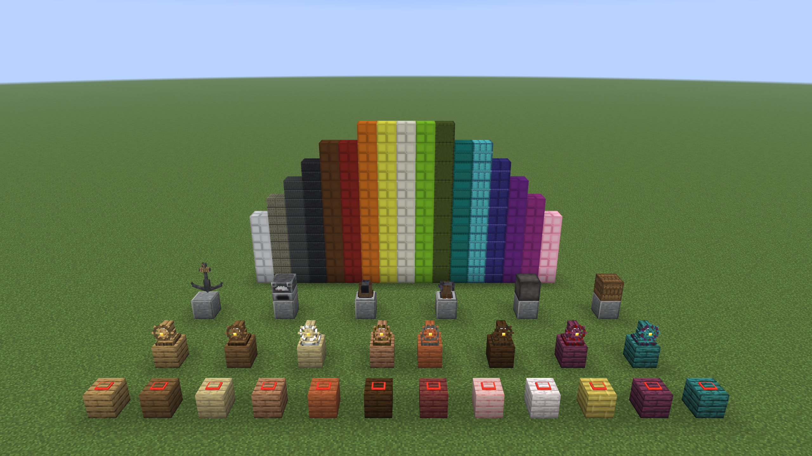

<a id="recipes"></a>
## 🛠️ Recipes

**All 32 original Eureka recipes are exactly the same as before.** If you know how to craft it in Eureka, you already know how to craft it here. The only additions are the Cannon and the Wireless Buttons. JEI shows every recipe in game.

### New recipes

**Cannon**

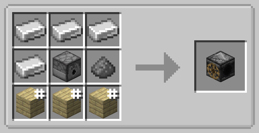

**Wireless Button**

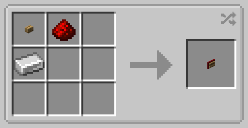

This one is shapeless, so the items can go anywhere in the grid. Use any wooden button. The wood of the button decides which of the 12 Wireless Buttons you get.

### Original Eureka recipes

A **#** on an item means any type of it works, like any planks or any wool.

<details>
<summary><b>Ship Helm</b></summary>

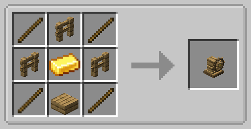

Comes in 8 wood types: oak, spruce, birch, jungle, acacia, dark oak, crimson and warped. Use the fences and slab of the wood you want.
</details>

<details>
<summary><b>Engine</b></summary>

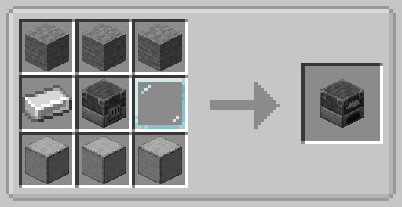

The last slot in the middle row is a Glass Pane. It's see-through, so it's hard to spot.
</details>

<details>
<summary><b>Anchor</b></summary>

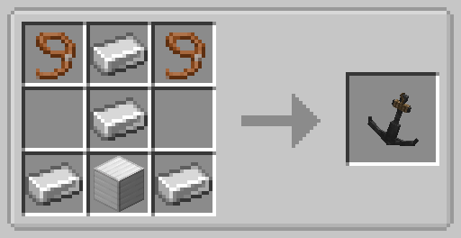
</details>

<details>
<summary><b>Ballast</b></summary>

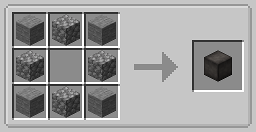
</details>

<details>
<summary><b>Floater</b> (makes 16)</summary>

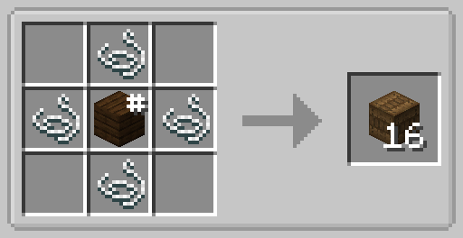
</details>

<details>
<summary><b>Balloon</b> (paper, leather, wool or phantom membrane)</summary>

Four materials work, and they make different amounts.

Paper makes 2

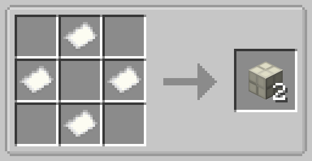

Leather makes 4

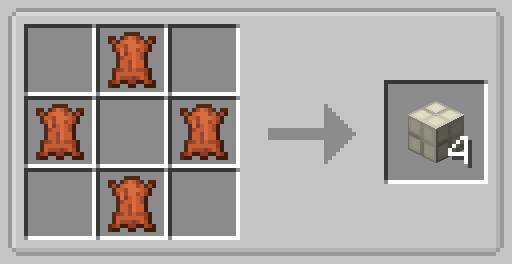

Wool makes 4

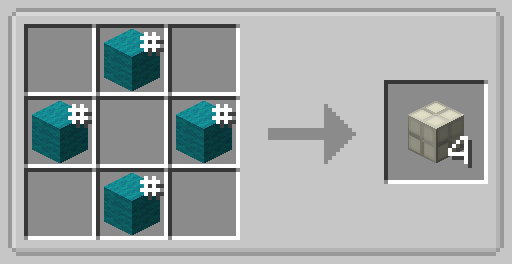

Phantom Membrane makes 32

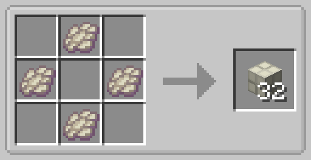
</details>

<details>
<summary><b>Colored Balloon</b> (all 16 colors)</summary>

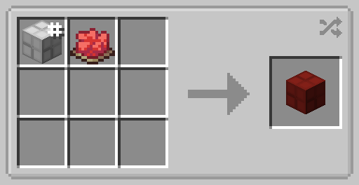

Any balloon plus any dye. This one is shapeless too.
</details>

## 🧩 Compatible mods

**Played through and tested on 26.3:**

| Mod | Version | Notes |
|---|---|---|
| Sodium | 0.9.3-beta.1 | Full test with ships, wiring and cannons. Sodium for 26.3 is still a beta. |
| JEI | 31.17.0.108 | Shows all the items and recipes from this mod. |
| Just Enough Resources | 1.11.0.58 | Works, but its villager tab is empty on 26.3. That's a JER issue. |

**Built-in support, loads without errors, not fully played through:** Iris 1.11.7, CC: Tweaked 1.120.3, Entity Model Features 3.3.12, Entity Texture Features 7.2.6, Sound Physics Remastered 1.5.2, Echo Chest 26.3.0.

**Not supported:** Create, Flywheel and Hex Casting support isn't included, and the BlueMap integration is turned off.

## ⚠️ Good to know

- Always back up your world before adding a ship mod.
- Worlds from Paper versions before 26.1 keep the Nether and End in separate folders, so those won't carry over by themselves.
- A button fires everything it's touching, like any redstone. Keep each button touching only its own cannon, or skip the button and wire the cannon to a seat.
- A button on the deck also powers the block under it, so a cannon directly below that block will fire too.
- A ship only moves while every chunk under it is loaded. Very long ships need a big view distance on the server.
- Blocks moved by pistons, placed by dispensers or with `/setblock` don't count as placed by a player.

## ❤️ Credits

All the credit for the incredible mods this is built on goes to the people who made them. Go show them some love.

**Original mods**

- **[Valkyrien Skies 2](https://github.com/ValkyrienSkies/Valkyrien-Skies-2)** by Tri0de and Rubydesic (LGPL-3.0)
- **[Eureka](https://github.com/ValkyrienSkies/Eureka)** by ewoudje, Tri0de, Rubydesic and millennIumAMbiguity (Apache-2.0)
- With help from Copper, Anarava and the VS Discord

**Physics**

- **VS Core** and the **Krunch** physics engine by the Valkyrien Skies team, included unchanged. These are not open source and aren't covered by this project's license.
- Powered in part by **NVIDIA PhysX**

**Included libraries**

- **Forge Config API Port** by Fuzs (MPL-2.0)
- **Fabric Language Kotlin** by FabricMC (Apache-2.0)
- **Classmate** by FasterXML (Apache-2.0)

**Port and upgrades** by BalloonKoala

## 🔧 Building from source

You need JDK 25, Gradle 9.8 and the VS Core bundle described in [libs/README.md](libs/README.md). The source here builds exactly the jar on the Releases page.

```
gradle build -x test
```

The mod ends up in `build/libs`. See [CHANGES.md](CHANGES.md) for everything that's different from the original mods.

## 📜 License

- This project is licensed under **LGPL-3.0-only**, see [LICENSE](LICENSE) and [LICENSE-GPL-3.0.txt](LICENSE-GPL-3.0.txt).
- The Eureka code stays under **Apache-2.0**, see [LICENSE-EUREKA.txt](LICENSE-EUREKA.txt).
- VS Core and the Krunch physics engine are closed source, belong to the Valkyrien Skies team and aren't part of this source. See [libs/README.md](libs/README.md).

<sub>Not an official Minecraft product. Not approved by or associated with Mojang or Microsoft.</sub>
